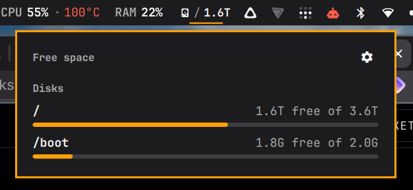

# Free Space

Free disk space in the Omarchy bar. Click it for every mounted disk, grouped
into Disks and Removable, each with free / total and a usage bar. Removable
disks get an Eject button. That is all it does: no folder breakdowns.

<p align="center"></p>

- Bar values turn yellow below 20% free and red below 10% free.
- On btrfs, the panel warns in plain words when all space is reserved even
  though free space looks fine (the state that can freeze a system).
- Eject runs `udisksctl unmount`, then `udisksctl power-off`; failures show
  the error under the row.

## Install

```sh
omarchy plugin add https://github.com/swaits/omarchy-freespace.git --enable
```

## Remove

```sh
omarchy plugin remove io.github.swaits.freespace --yes
```

## Dependencies

No packages to install beyond a stock Omarchy: it calls `lsblk`, `findmnt`,
`udisksctl` (eject) and `btrfs` (out-of-room check, btrfs disks only), which
Omarchy already ships.

## License

MIT, see `LICENSE`.

## Settings

Click the gear in the panel.

- **Format**: `free` (412G), `freeTotal` (412G/1.8T) or `percent` (22% free).
- **Show in bar**: tick which disks appear in the bar (default: `/`).

Both are stored on the widget entry in `~/.config/omarchy/shell.json`.
